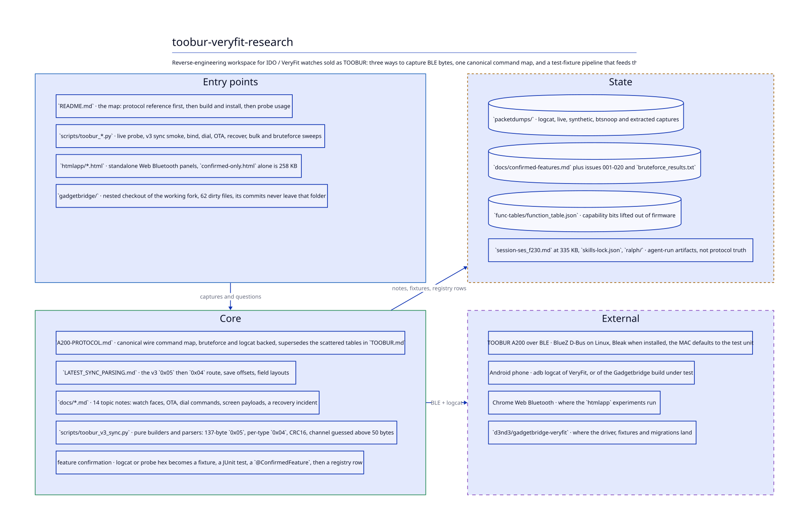

# toobur-veryfit-research

The research half of the TOOBUR driver: capture BLE traffic three ways, pin the bytes into `A200-PROTOCOL.md`, and turn them into JUnit fixtures for the Gadgetbridge fork.

Read it left to right:

- **Three front doors, one output format.** `adb logcat`, `scripts/toobur_ble_probe.py` (Bleak when installed, otherwise BlueZ D-Bus) and the `htmlapp` Web Bluetooth pages all end as `TX :` / `RX :` hex lines.
- **`A200-PROTOCOL.md` is the single wire truth.** `TOOBUR.md` keeps the background and its command tables are explicitly superseded, so read the protocol doc before any scattered table.
- **"Confirmed" is a test state, not an opinion.** Rows in `docs/confirmed-features.md` must match `@ConfirmedFeature` annotations, `ConfirmedFeaturesTest` fails on drift, and the fixtures live at `gadgetbridge/app/src/test/resources/toobur/fixtures/`.
- **`gadgetbridge/` is a raw gitlink, not a submodule.** There is no `.gitmodules`, so a fresh clone leaves it empty; locally it holds 62 modified files plus commits that the fork's `master` does not contain.
- **Bytes and transport are deliberately separate.** `scripts/toobur_v3_sync.py` only builds and parses frames (137-byte `0x05`, per-type `0x04`, CRC16), the probe owns the radio, and the channel is guessed from frame length — anything over 50 bytes is treated as bulk.

---

Diagram source: [`docs/system.d2`](docs/system.d2) · renderer: [`scripts/render-diagram.sh`](scripts/render-diagram.sh) (TALA layout, light + dark SVG, dark 0.5-scale PNG).
